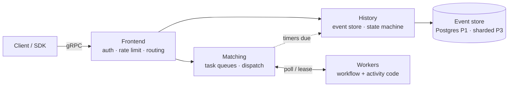

# Tandav — Domain Knowledge: Durable Workflow Engines

> The complete domain primer. Read this before any code. This document explains *what* durable workflow engines are, *why* they exist, the concepts that define them, how the industry builds them, and where every technology in Tandav's stack fits.

**Prerequisites:** none. **After reading:** you should be able to explain durable execution to a stranger, and defend design decisions in an interview.

---

## 1. The Problem: Long-Running Work

Software constantly performs processes that take **hours, days, or years**:

| Process | Duration | Failure-prone steps |
|---|---|---|
| Order fulfillment | hours–days | payment, inventory, courier dispatch, invoice |
| Subscription billing | forever (monthly) | card declines, retries, proration |
| User onboarding / KYC | days | external verification APIs, human approvals |
| Video/media pipeline | minutes–hours | transcode, thumbnail, CDN publish |
| Infrastructure provisioning | minutes–hours | VM create, DNS, TLS cert, health checks |
| Refund & dispute flow | days | bank APIs, SLA deadlines, escalations |

These are not HTTP requests. They are **stories that unfold over time across multiple services**. And the real world is hostile: processes crash, networks partition, APIs time out, machines get redeployed.

### What teams do without an engine (and why it hurts)

**Pattern A — status column + cron poller**
```sql
UPDATE orders SET status = 'paid' WHERE id = $1;
-- a cron job somewhere picks up 'paid' orders and tries shipping...
```
State is scattered across tables and job runners. A deploy in the middle of step 3 loses the work. "Where is order #421 stuck?" becomes archaeology across five dashboards.

**Pattern B — queue + consumer with retry counters**
A message queue retries failed messages, but *where was the process?* is stored nowhere. Multi-step logic gets smeared across consumer code with ad-hoc `if status = X` branches.

**Pattern C — in-memory orchestrator**
A service holds workflow state in memory. A restart or redeploy **erases history**. Every deploy is a small disaster.

The failure modes are always the same:

1. **Lost work** — crash between steps, nobody remembers
2. **Duplicate side effects** — retries charge the card twice
3. **No observability** — can't answer "what happened and why?"
4. **Deploy fear** — long-running jobs make every release dangerous
5. **Time is hard** — "wait 3 days, then remind" needs a durable timer, not `time.Sleep`

### The durable execution answer

**Write the process as code that never forgets where it was.** If anything crashes — the process, the machine, the whole datacenter — the workflow *resumes exactly where it left off*, with all its local variables intact, as if nothing happened.

```go
func OrderWorkflow(ctx workflow.Context, order Order) error {
    // Step 1: charge payment (retried automatically on failure)
    if err := workflow.ExecuteActivity(ctx, ChargePayment, order).Get(ctx, nil); err != nil {
        return err
    }
    // Step 2: wait 24 hours — durable! survives restarts, deploys, crashes
    workflow.Sleep(ctx, 24*time.Hour)
    // Step 3: dispatch courier
    return workflow.ExecuteActivity(ctx, DispatchCourier, order).Get(ctx, nil)
}
```

This is **durable execution**, and the systems that provide it are **durable workflow engines**. Temporal is the flagship; Tandav is our own.

---

## 2. What Exactly Is a Workflow Engine?

A durable workflow engine is infrastructure that guarantees:

| Guarantee | Meaning |
|---|---|
| **Durability** | Workflow state survives crashes, restarts, deploys |
| **Progress** | Every workflow eventually completes or fails *explicitly* — never silently |
| **Resumability** | After a crash, execution resumes mid-flow, local variables intact |
| **Retries** | Failed units of work retry with backoff, bounded and observable |
| **Timers** | "Wait until Tuesday" is durable — no memory held while waiting |
| **Visibility** | Full history of every execution: what ran, when, why it failed |
| **Isolation of side effects** | At-least-once execution safely maps to exactly-once *effects* |

### Workflow-as-code vs workflow-as-config

| | Workflow-as-code (Temporal, Tandav) | Workflow-as-config (BPMN: Camunda, Zeebe) |
|---|---|---|
| Definition | Go/Java/TS functions | XML/JSON diagrams of boxes and arrows |
| Expressiveness | Full language: loops, generics, libs | Limited to model elements |
| Testability | Ordinary unit tests | Engine-dependent simulation |
| Versioning | Code review, git, CI | Diagram diffs |
| Audience | Developers | Business analysts + developers |

Tandav is **workflow-as-code**, deliberately: you are learning to build infrastructure *for developers*, and the Temporal model has won the industry.

---

## 3. The Core Mental Model: Event Sourcing + Replay + Determinism

This is the single most important section of this document. If you understand these three ideas, you understand the whole genre.

### 3.1 Event history is the source of truth

A running workflow never stores "current state" as a mutable row. Instead, the engine appends every thing that happens to an immutable **event history**:

```
event 1: WorkflowExecutionStarted      {input: order#421}
event 2: ActivityTaskScheduled         {activity: ChargePayment}
event 3: ActivityTaskCompleted         {result: payment_id=pay_77}
event 4: TimerStarted                  {fire_at: 2026-10-26T12:00:00Z}
event 5: TimerFired                    {}
event 6: ActivityTaskScheduled         {activity: DispatchCourier}
...
```

Append-only. Never updated. Never deleted (until archival). This is **event sourcing**, and it buys two things: perfect auditability ("what happened to order #421?" = read its history) and the next idea.

### 3.2 State is reconstructed by replay

"Current state" is **computed**, not stored: the engine feeds the history through your workflow code from the beginning, and the code re-derives its variables. Because workflow code is a deterministic function of its history, replaying `event 1..5` puts the program counter and locals exactly where they were before the crash.

This is why a crash costs nothing: durable state = event log. Memory is always disposable.

### 3.3 Determinism: the price of replay

Replay only works if re-executing code against the same history produces the **same decisions**. So workflow code must be **deterministic**:

| ❌ Forbidden in workflow code | ✅ The durable alternative |
|---|---|
| `time.Now()` | `workflow.Now(ctx)` — replayed time from history |
| `rand.Intn()` | `workflow.SideEffect(...)` — recorded in history |
| Direct HTTP/DB calls | `workflow.ExecuteActivity(ctx, DoHTTPThing, ...)` |
| Goroutines racing on shared state | `workflow.Go`, `workflow.Await`, `workflow.Channel` — deterministic primitives |
| Iterating Go maps (random order!) | Sorted slices |
| Global mutable state | Pass state explicitly |

**Activities** are the escape hatch: all side effects live in activities (which run outside the deterministic sandbox), and the engine records their *results* in history, so replay just reads recorded results instead of re-executing them.

> **The dance analogy:** the choreography (workflow) must be reproducible beat-for-beat; the real-world effects (activities) are where the dancer actually touches the ground. Tandav — the dance — replays; the drumbeat stays recorded.

### 3.4 Commands complete the loop

During execution, workflow code doesn't perform effects — it emits **commands** to the engine: `ScheduleActivity`, `StartTimer`, `RecordMarker`, `CompleteWorkflow`. The engine validates commands against history (during replay, a command must match the next history event — a mismatch is a *nondeterminism error*, caught loudly in dev), executes them, appends new events. The cycle:

```
history → replay → workflow code → commands → engine executes → new events → history
```

That loop is the entire engine. Everything else is production hardening.

---

## 4. Core Concepts (The Complete Vocabulary)

### 4.1 Workflows

| Term | Meaning |
|---|---|
| **Workflow definition** | The Go function describing the process (the choreography) |
| **Workflow execution** | One running instance: `workflow_id` (business key, e.g. `order-421`) + `run_id` (unique per execution) |
| **Workflow type** | Registered name of the definition (`"order-fulfillment"`) |
| **Input / result** | JSON-serializable payloads |
| **Status** | `running → completed \| failed \| cancelled \| terminated \| timed-out` |
| **Continue-As-New** | Compact history by starting a fresh run with carried state — for *infinite* workflows (cron) |

**Workflow ID reuse policy** matters: if `order-421` already has a running execution, what happens when someone starts it again? (Reject / allow-concurrent / terminate-and-restart — an API design decision you'll make.)

### 4.2 Activities

The unit of real work. Everything with a side effect is an activity: call Stripe, write to Postgres, send an email.

| Concept | Meaning |
|---|---|
| **Retry policy** | Initial interval, backoff coefficient, max interval, max attempts, non-retryable error types |
| **Start-to-close timeout** | Max time one attempt may run |
| **Schedule-to-close timeout** | Max total time including queueing + retries |
| **Heartbeat timeout** | Long activities ping periodically; missed pings → attempt dead → retried |
| **Idempotency key** | Dedup token passed to the external system so retries don't double-charge |

**Key semantic:** activities run **at least once**. They *will* be retried; they *may* run twice (worker dies after the side effect but before the ack). Activities must be **idempotent** or use idempotency keys. This is the honest contract of every distributed task system.

### 4.3 Task queues, workers, matching

| Concept | Meaning |
|---|---|
| **Task queue** | Named queue of pending work (workflow tasks and activity tasks are usually separate queues) |
| **Worker** | Long-running process that polls a queue, executes code, reports results |
| **Lease** | A worker *leases* a task for a time window; if it dies, the lease expires and the task is redelivered |
| **Sticky execution** | Optimization: a workflow's tasks prefer the same worker (warm replay cache) |
| **Dispatcher** | Engine-side matcher pairing tasks to pollers |

**Why queues decouple everything:** the engine doesn't know *where* work runs. Workers can be anywhere — same binary in Phase 1, a fleet across machines in Phase 2. Scale compute independently of the engine. Backpressure falls out naturally: if workers are slow, tasks queue up instead of overloading.

### 4.4 Time

| Concept | Meaning |
|---|---|
| **Durable timer** | `workflow.Sleep` / `workflow.NewTimer` — survives restarts; millions pending simultaneously (timer wheel) |
| **Workflow execution timeout** | Max lifetime of the whole workflow |
| **Cron workflows** | Re-fire on a schedule — timers + continue-as-new |
| **Scheduled actions** | "Email on day 3, cancel on day 14 if unpaid" — just timers |

Time in workflows is **replayed time** (`workflow.Now`), never wall-clock — determinism rule.

### 4.5 Interaction with the outside world

| Concept | Direction | Meaning |
|---|---|---|
| **Signal** | in → workflow | External event delivered mid-flight ("courier arrived"). Deterministic, recorded in history. |
| **Query** | in → workflow (read-only) | Inspect state without affecting it. Not recorded in history. |
| **Update** | in → workflow (mutating) | Validated, synchronous mutation (Temporal's newest primitive) |
| **Webhook** | workflow → out | Notify external systems on milestones — with retries + signatures |
| **Broker events** | workflow → out | Emit domain events (`workflow.completed`) for other services |

Signals are how workflows become *reactive*: a workflow can await a signal for days while holding zero resources.

### 4.6 Parent/child & composition

- **Child workflows** — one workflow starts another; policies govern what happens to children when the parent completes/fails/cancels (`TERMINATE`, `ABANDON`, `REQUEST_CANCEL`).
- **Workflows all the way down** — big processes decompose into child workflows, just like functions.

### 4.7 Observability concepts

| Concept | Meaning |
|---|---|
| **Event history** | The audit trail (source of truth) |
| **Search attributes** | Indexed metadata (`status`, `customer_id`, `region`) for listing executions |
| **Visibility API** | Query executions across the system ("all failed workflows of type X since Tuesday") |
| **Metrics** | task latency, schedule-to-start lag, backlog depth, retry rate |
| **Tracing** | span per workflow/activity across services |

Being able to answer *"what happened to workflow X?"* in seconds is the product's soul.

---

## 5. Anatomy of One Execution (the full trace)

To make it concrete — `order-421` from start to finish:

```
1.  Client → API:  StartWorkflow("order-fulfillment", workflow_id="order-421", input={...})
2.  Frontend validates, appends WorkflowExecutionStarted to history (Postgres)
3.  Matching enqueues a workflow task on queue "order-workflows"
4.  Worker (picks up lease) replays history → runs workflow code → emits command
       ScheduleActivity(ChargePayment)
5.  Engine appends ActivityTaskScheduled, enqueues activity task on "order-activities"
6.  Worker executes ChargePayment → Stripe charges $50 → acks ActivityTaskCompleted
       (if it crashed before acking: lease expires → task redelivered → activity runs again
        → Stripe idempotency key ensures single charge)
7.  Workflow code resumes with the recorded result → emits StartTimer(24h)
8.  Timer lands in the timer store... 24 hours pass...
9.  TimerFired → workflow task → replay → ScheduleActivity(DispatchCourier)
10. Courier activity completes → workflow code returns → WorkflowExecutionCompleted
11. Completion event → webhook POST to merchant, event emitted to broker, UI shows ✓
```

Note what is durable at every step (history) and what is disposable (worker memory). Note what gets retried (activities) and what doesn't (workflow code — it *replays* instead).

---

## 6. Delivery Semantics & Correctness

| Layer | Guarantee | How |
|---|---|---|
| Task delivery | **At-least-once** | Leases + redelivery on timeout/crash |
| Workflow execution | **Exactly-once** (effectively) | Workflow tasks deduplicated by history position; replay is pure |
| Activity execution | **At-least-once** | Retries, redelivery |
| Activity *effects* | **Exactly-once** (your job) | Idempotency keys, dedup tables, unique constraints |
| Timers | **At-least-once firing** | Durable timer store + redelivery |
| Signals | **At-least-once** | Dedup keys for external senders |

The industry phrase: **"exactly-once execution is impossible; exactly-once *effects* are achievable."** Tandav will be honest about this — and teach users to write idempotent activities.

### Idempotency patterns for activities
1. **Idempotency keys** at the external API (Stripe, PayPal support this)
2. **Dedup table** in your DB: `INSERT ... ON CONFLICT DO NOTHING` with a unique business key
3. **Natural idempotency** — `set balance = 100` vs `balance += 100`
4. **Token passing** — record a `dedup_token` via `workflow.SideEffect` before the side effect

---

## 7. Failure Handling Patterns

| Pattern | Problem | Mechanism |
|---|---|---|
| **Retry + backoff (jitter)** | Transient failures | Activity retry policy |
| **Timeouts** | Hung calls | Start-to-close / schedule-to-close |
| **Heartbeats** | Worker died mid-activity | Heartbeat timeout → attempt retried elsewhere |
| **Non-retryable errors** | Permanent failures (card declined) | Fail immediately, no burn |
| **Dead-letter / escalation** | Poison tasks | Max attempts → workflow fails *explicitly* or routes to human-review workflow |
| **Compensation (saga)** | Step N fails after 1..N-1 succeeded | Undo activities in reverse |
| **Rate limiting** | Downstream quota | Per-queue dispatch throttling |
| **Circuit breaking** | Flaky dependency | Fail fast in activity layer |

### Sagas — the flagship use case

A **saga** = a long transaction across services, maintained as local transactions + compensating actions:

```
ReserveInventory → ChargePayment → DispatchCourier
       │                 │                │
   (fail)           (fail)           (fail)
       ↓                 ↓                ↓
   (nothing)     ReleaseInventory   RefundPayment + ReleaseInventory
```

Workflow engines are *saga machines*: the workflow is the saga coordinator; compensation is just `if err != nil` branches calling undo activities. This is why payments, orders, and provisioning are the #1 engine use cases.

---

## 8. Comparison With Alternatives

| Approach | Pros | Cons vs a workflow engine |
|---|---|---|
| Cron + status columns | Simple | Lost work, scattered state, no visibility, deploy risk |
| Kafka consumers + state store | High throughput streaming | No timers/durability semantics; you rebuild the engine badly |
| BPMN engine (Camunda/Zeebe) | Visual modeling | Config-driven, heavyweight, less expressive |
| AWS Step Functions | Managed, reliable | Vendor lock-in, JSON state machines, per-transition pricing |
| Azure Durable Functions | Managed, code-first | Azure lock-in |
| Temporal / Tandav style | Code-first, portable, complete semantics | You operate the engine (self-hosted) |

**When NOT to use an engine:** simple fire-and-forget jobs, high-frequency short tasks, pure streaming. An engine is for **long-running, multi-step, failure-prone business processes**.

---

## 9. Industry Landscape (Who Builds This — In Go)

| System | Company | Language | Notes |
|---|---|---|---|
| **Temporal** | Temporal Technologies | **Go** | Genre-defining; ex-Uber (Cadence) |
| **Cadence** | Uber (open source) | **Go** | Temporal's ancestor |
| **Inngest** | Inngest | **Go** | Event-driven durable functions |
| **Restate** | Restate | Rust | Lightweight durable execution (new wave) |
| AWS Step Functions | Amazon | — | Managed, ASL/JSON |
| Azure Durable Functions | Microsoft | — | Managed |
| Camunda / Zeebe | Camunda | Java | BPMN heritage |
| Conductor | Netflix (open source) | Java | Microservice orchestration |
| Windmill | Windmill Labs | Rust | Script/workflow platform |

**Notable users of the Temporal model:** Stripe, Coinbase, Netflix, Snap, DoorDash, HashiCorp, Lyft, Instacart, Box.

**Why Go dominates this genre:** millions of in-flight workflows ≈ millions of goroutines (KB each). Channels model task dispatch natively. Static binaries make workers trivial to deploy. gRPC is Go infra's native tongue.

---

## 10. Use-Case Catalog (What Gets Built On Engines)

1. **Order & payment sagas** — the classic (see §7)
2. **Subscription & billing** — durable cron: charge monthly, retry declines, pause on failure
3. **Provisioning pipelines** — VM → DNS → TLS → health check → notify (with rollback)
4. **Media processing** — upload → transcode → thumbnail → CDN → index
5. **Data pipelines** — ETL with checkpoints, backfills ("re-run all workflows for yesterday")
6. **Human-in-the-loop approvals** — request approval → await signal for days → continue
7. **Incident response automation** — alert → remediation runbook with escalation timers
8. **Game session lifecycles** — matchmaking → session → scoring → settlement
9. **Distributed transactions** across microservices (saga coordinator)
10. **AI/LLM pipelines** — multi-step agent runs with retries and human approval

---

## 11. How the Engine Itself Is Built (Decomposition)

Temporal's real architecture is the blueprint (Tandav mirrors it, monolith-first):



| Service | Responsibility | Scale axis |
|---|---|---|
| **Frontend** | Public API: start/signal/query/cancel, auth, rate limiting | stateless, horizontal |
| **History** | Append events, drive workflow state machine, own execution state | sharded by workflow ID (P3) |
| **Matching** | Task queues, pair tasks with polling workers, leases | per-queue |
| **Workers** | Execute user workflow/activity code (SDK) | per-CPU, anywhere |

The **task lifecycle** end-to-end:

```
API command → History appends event → Matching enqueues task →
Worker leases task → executes (replay or activity) → acks result →
History appends result event → (new tasks may enqueue) ...
```

Phase 1 keeps all four roles **in one Go binary** (in-process channels instead of network queues). Phase 2 splits them along these exact seams.

---

## 12. Where Tandav's Technology List Fits

| Technology | Role in Tandav | Domain concept it serves |
|---|---|---|
| **Microservices** | Frontend / History / Matching / Workers split (P2) | Engine decomposition along responsibility seams |
| **API gateway** | Edge: JWT auth, rate limiting, routing, versioning | Frontend = the gateway of the engine |
| **gRPC** | Engine↔worker, service↔service, streaming histories | The genre's native protocol (Temporal's public API is gRPC) |
| **Event-driven** | Event sourcing at the core; task queues; emits `workflow.*` events | The engine IS an event-sourced system |
| **WebSocket** | Dashboard: live execution view, streaming history, queue depths | Real-time observability |
| **Webhooks** | Out: milestone notifications with retries+signatures. In: external events → signals | Integration with the outside world |
| **PostgreSQL** | Event store, tasks, timers (P1) | Durable storage of the source of truth |
| **NATS** (P2) | Distributed task queues + event fan-out | Decoupled, scalable dispatch |

Nothing is decorative — each technology is load-bearing for a named domain concept.

---

## 13. Interview Angles (What This Domain Teaches You To Discuss)

- Event sourcing vs state storage — trade-offs, replay cost, compaction (continue-as-new)
- Exactly-once effects over at-least-once execution — idempotency patterns
- Durable timers at scale — timer wheels, sharded scheduling
- Determinism constraints and how SDKs enforce them (workflow sandbox)
- Saga/compensation vs two-phase commit
- Task queue semantics: leases, redelivery, visibility timeouts, backpressure
- Shard/partition strategy for histories (by workflow ID), hot-spotting
- Versioning long-running workflows when code changes (patching APIs)
- API design: workflow ID reuse policies, idempotent start requests
- Observability: making every execution debuggable

Classic prompts you'll be ready for: *"Design Stripe's payment retry system"*, *"Design a subscription billing platform"*, *"Design AWS Step Functions"*.

---

## 14. Quick Glossary

| Term | One-liner |
|---|---|
| Workflow | Durable function describing a long-running process |
| Workflow execution | One instance: `workflow_id` + `run_id` |
| Activity | Unit of side-effectful work, retried at-least-once |
| Event history | Append-only log — the source of truth |
| Replay | Re-executing workflow code over history to rebuild state |
| Determinism | Same history → same decisions; required for replay |
| Command | Workflow's request to the engine (schedule activity, timer, ...) |
| Task queue | Named queue of pending work for workers |
| Worker | Process executing workflow/activity code |
| Lease | Time-bounded task ownership; expiry → redelivery |
| Timer | Durable future wake-up |
| Signal | External event into a running workflow |
| Query | Read-only state inspection |
| Continue-As-New | History compaction for long/infinite workflows |
| Saga | Multi-step transaction with compensation on failure |
| Idempotency key | Dedup token making retries safe |
| Search attributes | Indexed fields for the visibility API |
| Heartbeat | Activity liveness ping |
| Compensation | Undo activity for a failed saga step |

---

## 15. Further Reading

1. **Temporal docs** — [docs.temporal.io](https://docs.temporal.io) — especially *Workflows*, *Activities*, *Temporal Server architecture* (our blueprint)
2. **"What is Durable Execution?"** — Temporal / Restate / Inngest engineering blogs
3. **Designing Data-Intensive Applications** (Kleppmann) — ch. 4, 5, 7, 11 — read JIT with our phases
4. **The Go Programming Language** (Donovan & Kernighan) — ch. 1–5 before Phase 1 coding
5. **gRPC** — [grpc.io/docs](https://grpc.io/docs/) — for Phase 2
6. **Event sourcing** — Martin Fowler's *Event Sourcing* article + Greg Young's talks

---

*Next: [02-phase-1-system-design.md](02-phase-1-system-design.md) — the monolith, designed in full detail.*
