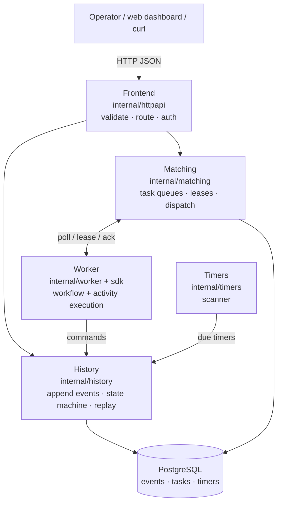
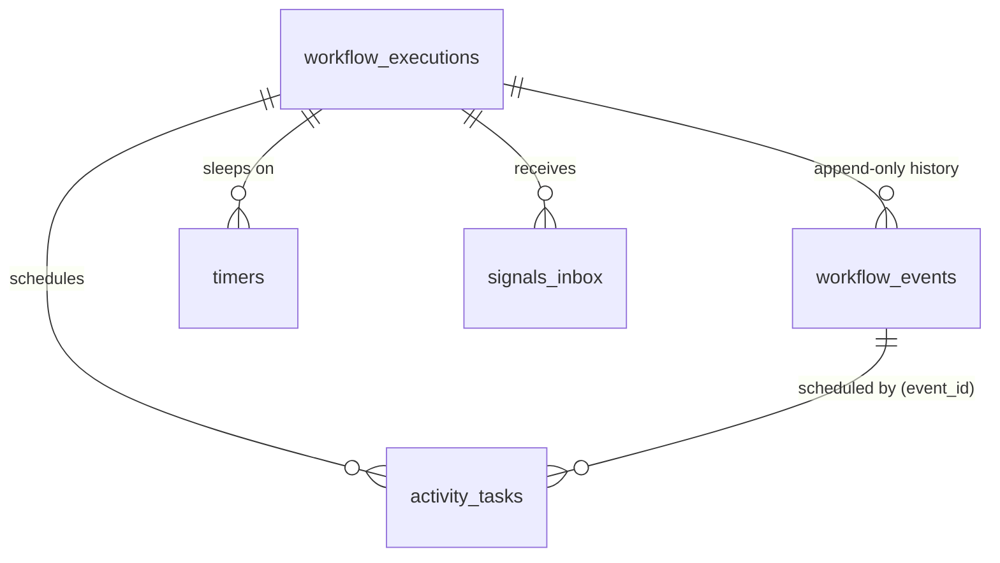
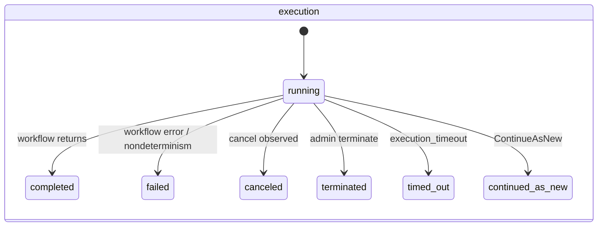
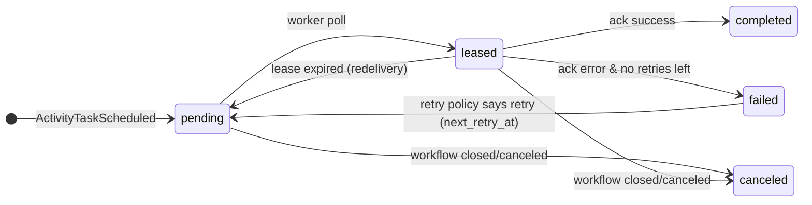

# Tandav — Phase 1 System Design: "The Monolith Engine"

> **Tandav** — *Creation. Preservation. Destruction. On beat.*
> Phase 1 of 3: a single Go binary that *is* a complete durable workflow engine — front door, history, matching, and one in-process worker — backed by PostgreSQL.

| | |
|---|---|
| **Status** | Draft v1.1 — infrastructure spine decided (migrations · DB access · HTTP: §13 D11–D15); rest of the design remains Draft v1 |
| **Date** | 2026-10-25 |
| **Scope** | Phase 1 only. Phases 2–3: [03-roadmap-phase-2-3.md](03-roadmap-phase-2-3.md) |
| **Prerequisite** | [01-domain-knowledge.md](01-domain-knowledge.md) — read first |

---

## 1. Product Context & Phase Map

Tandav is a durable workflow engine in Go, inspired by Temporal: write long-running business processes as code; the engine guarantees they survive crashes, retry failures, honor timers, and remain fully auditable.

**Phase 1 is deliberately a monolith.** All four engine roles (Frontend, History, Matching, Worker) live in one binary, communicating via in-process channels, persisting to PostgreSQL. This is not a shortcut — Temporal-scale separation is *earned* in Phase 2 by extracting these exact seams. The single-binary engine is also a complete, honest product: it already delivers durable execution.

| Phase | Shape | New muscles |
|---|---|---|
| **P1 (this doc)** | One binary + Postgres + Go SDK + `web/` dashboard | Event sourcing, replay, determinism, task leasing, timers |
| P2 | Engine split into gRPC services + NATS queues + worker fleet + webhooks | RPC, messaging, horizontal scale, integrations |
| P3 | HA, history sharding, observability, rate limiting | Partitioning, consensus-free coordination, ops |

---

## 2. Goals & Non-Goals

### Goals (Phase 1 "done" means all of these)

- **G1 — Durable execution**: a workflow started against the engine survives engine restarts and resumes mid-flow with state intact (proven by tests).
- **G2 — The full core semantics**: activities with retry policies, durable timers, signals, queries, cancellation, continue-as-new.
- **G3 — A real Go SDK**: workflow authors write deterministic functions using `workflow.*` primitives; a worker runs them.
- **G4 — Full visibility**: every execution has a complete, readable event history via API (`web/` dashboard reads it).
- **G5 — Honest semantics**: at-least-once activity execution, leases with redelivery, documented idempotency patterns.
- **G6 — Demo showcase**: an order-saga workflow (payment → inventory → shipping with compensation) end-to-end in the dashboard.

### Non-Goals (deferred, named)

| Deferred to | What | Why |
|---|---|---|
| P2 | gRPC public API, NATS task queues, multi-node workers | Extraction is the P2 lesson |
| P2 | Webhooks (out), broker events, dashboard live stream (WebSocket) | Integration layer after core is solid |
| P2 | Sticky execution / replay cache optimization | Performance, not correctness |
| P3 | History sharding, HA engine replicas, archival | Scale & ops |
| P3 | Rate limiting, quotas, multi-tenancy, auth (real) | Production hardening |
| P3 | Workflow versioning/patching APIs | Real concern once code evolves |
| — | Workflow-as-config / BPMN, visual designer | Out of scope forever |

**Rule:** if it doesn't teach a P1 concept (event sourcing, replay, determinism, leases, timers), it's deferred.

---

## 3. Actors & Roles

| Actor | What they do in P1 |
|---|---|
| **Workflow author** (you, a developer) | Writes workflow + activity functions with the Go SDK |
| **Operator** | Starts/cancels/terminates executions, reads histories via API & dashboard |
| **External systems** | Called by activities (payment API, email sender — simulated in demo); signal senders |
| **Worker** | The in-process execution engine polling task queues |

P1 has no end-users with accounts — auth is a static bearer token (`TANDAV_API_TOKEN`) to keep the surface honest without dragging in user management. Real auth = P3.

---

## 4. Architecture (Four Roles, One Binary)



The four roles map 1:1 to Temporal's real services ([01-domain-knowledge.md](01-domain-knowledge.md) §11). In P1 they are packages + goroutines; in P2 they become network services **without redesign** — the interfaces between them are the seams.

### The P1 task lifecycle (in-process)

```
API StartWorkflow → History: BEGIN txn { insert execution, append Started, insert workflow_task } → commit
Matching: workflow_task pending → in-process dispatch to Worker
Worker: lease task → replay history → run workflow code → emit command ScheduleActivity
History: append ActivityTaskScheduled + insert activity_task (state=pending)
Matching: dispatch activity_task → Worker executes the activity fn (with retry policy)
Worker: ack result → History: append ActivityTaskCompleted/Failed
... workflow continues / completes → History: append Completed, close execution
```

**Crash rule (the whole point):** if the engine dies anywhere, on restart the task scanner finds `pending`/`leased`-expired tasks and re-dispatches them. Worker memory is always disposable; the DB is the dance's memory.

---

## 5. Codebase Layout

```
tandav/
├── cmd/
│   ├── tandav-engine/main.go      # wires config → store → history/matching/timers → HTTP
│   └── tandav-demo/main.go        # registers demo workflows + runs the in-process worker
├── sdk/                           # what workflow authors import
│   ├── workflow/                  # Context, ExecuteActivity, Sleep, Timer, Await, SideEffect, Now, Channel
│   ├── activity/                  # Context, heartbeat, retry metadata
│   └── worker/                    # registration + poll/execute/ack loop
├── internal/
│   ├── config/                    # env config, validated at startup
│   ├── domain/                    # Execution, Event, Task, Timer types + state machines (pure)
│   ├── history/                   # append events, replay driver, command validator
│   ├── matching/                  # task queues, leasing, redelivery
│   ├── timers/                    # durable timer store + scanner (the damaru 🥁)
│   ├── store/                     # Store interface · migrate.go (goose boot runner)
│   │   └── postgres/              # impl: sqlc.yaml · queries/*.sql · db/ (generated, committed)
│   ├── httpapi/                   # router, handlers, middleware, error envelope
│   └── logx/                      # slog setup, request/execution-scoped loggers
├── migrations/                    # goose: numbered, up-only, DDL-only (also the sqlc schema source)
├── web/                           # existing React dashboard (Vite + Tailwind)
├── examples/
│   └── ordersaga/                 # the showcase: payment → inventory → shipping + compensation
├── docs/                          # these documents
├── Makefile
├── docker-compose.yml             # postgres + engine
└── go.mod                         # module: github.com/<you>/tandav
```

**Dependency direction:** `sdk` is standalone (authors import only it); `internal/*` never imports `sdk` internals (engine and SDK share `internal/domain` event vocabulary via the `sdk` public types). `httpapi → history/matching → store`; `domain` is pure.

---

## 6. The Engine Core (design decisions)

### 6.1 Event loop & command protocol

A workflow "step" is: **take the workflow task → replay history → run workflow code → collect commands → apply commands transactionally → append events**. Commands (P1):

| Command | Effect |
|---|---|
| `ScheduleActivity` | append `ActivityTaskScheduled` + insert activity task |
| `StartTimer` / `CancelTimer` | append `TimerStarted`/`TimerCanceled` + timer row |
| `CompleteWorkflow` / `FailWorkflow` | append terminal event + close execution |
| `ContinueAsNew` | close execution with `ContinuedAsNew` + start new run with carried input |
| `RecordMarker` | append `MarkerRecorded` (side effects / versioning notes) |

**Replay validation:** during replay, each command produced by workflow code must match the corresponding history event (type + position). Mismatch → `NondeterminismError` → workflow task fails with a loud, diagnosable error (in P1 we fail the execution with that error and surface it in history — the humane choice for a learning engine).

### 6.2 Determinism enforcement (P1 pragmatic version)

- The SDK provides deterministic primitives (`workflow.Now`, `workflow.SideEffect`, `workflow.Channel`, `workflow.Await`); workflow code that bypasses them is *their* bug — we catch it via replay tests.
- **Golden-history replay tests** (§11) are the enforcement mechanism: record a history, replay it in CI forever.
- Map iteration, goroutines, wall-clock: documented in the SDK and caught by replay mismatch.

### 6.3 Leasing & redelivery (Matching)

- Workers call `Poll(task_queue)` → engine returns a leased task with `lease_expires_at = now + 30s`.
- Worker must `Ack` (with result) or `Heartbeat` (extends lease) before expiry.
- Scanner (every 5s in P1) reclaims `leased` tasks past expiry → back to `pending`. `attempts` counts *deliveries*: it is incremented at lease time (so redelivery and retry both count; the scanner and `FailTask` never touch it).
- Attempts respect the activity's retry policy: `next_retry_at = now + min(initial * backoff^attempts, max_interval)` + jitter.

### 6.4 Durable timers (the damaru)

- `timers` table with `fire_at`; scanner polls `fire_at <= now AND state='pending'` every second (P1: `SKIP LOCKED` to stay crash-safe).
- Firing appends `TimerFired` and enqueues a workflow task. The workflow never holds memory while sleeping.
- P2 replaces polling with a sharded timer dispatcher; the table contract stays.

### 6.5 Workflow ID reuse policy (P1)

Starting a workflow whose `workflow_id` already has a **running** execution → `409 conflict` (with the existing run_id). Closed executions allow reuse (new run_id). Configurable policy (`REJECT_DUPLICATE` default; `ALLOW_CONCURRENT`, `TERMINATE_EXISTING` reserved for P2).

---

## 7. API Design (P1: REST/JSON; gRPC in P2)

### Conventions

| Topic | Convention |
|---|---|
| Base path | `/v1` |
| Auth | `Authorization: Bearer $TANDAV_API_TOKEN` (static, P1) |
| Format | JSON; `snake_case`; RFC 3339 timestamps; IDs = UUIDv7 |
| Pagination | `?limit=20&offset=0` on list endpoints |
| Request ID | per-request, echoed in `X-Request-ID`, in every log line & error |
| Errors | single envelope: `{ "error": { "code", "message", "request_id" } }` |

### Endpoints

| Method | Path | Description |
|---|---|---|
| POST | `/v1/workflows` | Start: `{ "workflow_id", "type", "task_queue", "input", "options": { "execution_timeout", "retry_policy" } }` → `202` + execution ref. Duplicate running id → `409` |
| GET | `/v1/workflows` | List executions: `?type=&status=&task_queue=&limit=&offset=` |
| GET | `/v1/workflows/{workflow_id}` | Describe: status, run_id, timings, pending tasks |
| GET | `/v1/workflows/{workflow_id}/history` | **The product's soul**: full event history, paginated |
| POST | `/v1/workflows/{workflow_id}/signals` | `{ "name", "input", "dedup_key" }` → `202`; unknown name → `400`; dedup_key reuse → idempotent `202` |
| POST | `/v1/workflows/{workflow_id}/query` | `{ "name", "args" }` → result from live workflow state (replay-based, read-only) |
| POST | `/v1/workflows/{workflow_id}/cancel` | Cooperative cancel → workflow observes cancellation |
| POST | `/v1/workflows/{workflow_id}/terminate` | Admin kill: `{ "reason" }` — terminal immediately |
| GET | `/v1/queues` | Queue depths + backlog age (dashboard) |
| GET | `/health` | Liveness + version |

**Worker API (P1 in-process, P2 gRPC):** `Poll(task_queue, worker_id)`, `Ack(task_id, result|error)`, `Heartbeat(task_id, details)`. Documented as an interface in `internal/matching` now — it is the future gRPC contract.

### Example — start a saga

```http
POST /v1/workflows
{ "workflow_id": "order-421",
  "type": "order-saga",
  "task_queue": "default",
  "input": { "order_id": "421", "amount_paisa": 49900, "customer": {...} } }
```

```json
202 Accepted
{ "data": { "workflow_id": "order-421", "run_id": "0193...", "status": "running", "started_at": "..." } }
```

---

## 8. Data Model (PostgreSQL)



### workflow_executions

| Column | Type | Notes |
|---|---|---|
| run_id | uuid v7 | PK |
| workflow_id | text | business key; `UNIQUE (workflow_id) WHERE status='running'` |
| type | text | e.g. `order-saga` |
| status | text | `running\|completed\|failed\|canceled\|terminated\|timed_out\|continued_as_new` |
| task_queue | text | |
| input / result / error | jsonb | |
| search_attrs | jsonb | indexed (GIN) — visibility filters |
| parent_run_id | uuid | nullable (child workflows, P2-ready) |
| last_event_id | bigint | monotonic per run |
| started_at / closed_at / updated_at | timestamptz | |

### workflow_events (the source of truth)

| Column | Type | Notes |
|---|---|---|
| run_id | uuid | FK |
| event_id | bigint | sequence per run; `PRIMARY KEY (run_id, event_id)` |
| event_type | text | `ExecutionStarted`, `ActivityTaskScheduled`, `ActivityTaskCompleted`, `TimerStarted`, `TimerFired`, `SignalReceived`, `MarkerRecorded`, `ExecutionCompleted`, ... |
| payload | jsonb | event-specific data |
| created_at | timestamptz | append-only; no updates ever |

### activity_tasks

| Column | Type | Notes |
|---|---|---|
| task_id | uuid v7 | PK |
| run_id / event_id | | links to the `ActivityTaskScheduled` event |
| type / input | text / jsonb | |
| state | text | `pending\|leased\|completed\|failed\|canceled` (see state diagram) |
| attempts | int | |
| lease_owner / lease_expires_at | text / timestamptz | nullable |
| next_retry_at | timestamptz | backoff scheduling |
| last_error | jsonb | |
| idempotency_key | text | nullable, propagated to the activity |

### timers

| Column | Type | Notes |
|---|---|---|
| timer_id | uuid v7 | PK |
| run_id / event_id | | links to `TimerStarted` |
| fire_at | timestamptz | indexed for the scanner |
| state | text | `pending\|fired\|canceled` |

### signals_inbox

| Column | Type | Notes |
|---|---|---|
| signal_id | uuid v7 | PK |
| run_id | uuid | |
| name / input | text / jsonb | |
| dedup_key | text | `UNIQUE` nullable — inbound idempotency |
| received_at / processed_at | timestamptz | |

### workers (P1 visibility)

| Column | Type | Notes |
|---|---|---|
| worker_id | text | PK |
| task_queue | text | |
| last_heartbeat_at | timestamptz | |

### State machines (implemented as pure data in `internal/domain`)





### Indexes

| Index | Purpose |
|---|---|
| `uq_running_workflow` — `UNIQUE (workflow_id) WHERE status='running'` | reuse policy + fast lookup |
| `ix_events_run` — `(run_id, event_id)` | replay reads |
| `ix_tasks_queue_state` — `(task_queue, state, next_retry_at)` | poll & reclaim scans |
| `ix_timers_due` — `(state, fire_at)` | timer scanner |
| `ix_exec_search` — GIN on `search_attrs` | visibility queries |

---

## 9. The Go SDK (what makes Tandav a *product*)

```go
// examples/ordersaga — the P1 showcase (illustrative)
func OrderSaga(ctx workflow.Context, in OrderInput) (OrderResult, error) {
    var payment PaymentResult
    if err := workflow.ExecuteActivity(ctx, ChargePayment, in).Get(ctx, &payment); err != nil {
        return OrderResult{}, err            // nothing to compensate yet
    }
    if err := workflow.ExecuteActivity(ctx, ReserveInventory, in).Get(ctx, nil); err != nil {
        _ = workflow.ExecuteActivity(ctx, RefundPayment, payment).Get(ctx, nil) // compensation
        return OrderResult{}, err
    }
    workflow.Sleep(ctx, 30*time.Minute)      // durable prep window
    if err := workflow.ExecuteActivity(ctx, ShipOrder, in).Get(ctx, nil); err != nil {
        _ = workflow.ExecuteActivity(ctx, ReleaseInventory, in).Get(ctx, nil)
        _ = workflow.ExecuteActivity(ctx, RefundPayment, payment).Get(ctx, nil)
        return OrderResult{}, err
    }
    return OrderResult{Shipped: true}, nil
}
```

SDK surface (P1):

| Primitive | Purpose |
|---|---|
| `workflow.ExecuteActivity(ctx, fn, args...)` | schedule + await (returns `Future`) |
| `workflow.Sleep / workflow.NewTimer` | durable timers |
| `workflow.Now(ctx)` | replayed time |
| `workflow.SideEffect(ctx, fn)` | record nondeterministic input into history |
| `workflow.Await(ctx, cond)` / `workflow.Channel` | deterministic coordination (signals) |
| `workflow.GetSignalChannel(ctx, name)` | receive signals |
| `workflow.NewDisconnectedContext` | cleanup work during cancellation |
| `activity.RecordHeartbeat(details)` | liveness for long activities |
| `activity.GetInfo(ctx)` | attempts, idempotency key, deadlines |

**Worker contract:** `worker.RegisterWorkflow(fn)`, `worker.RegisterActivity(fn)`, `worker.Run(ctx)` — poll/execute/ack loops until `ctx` cancel (graceful shutdown finishes in-flight attempts).

---

## 10. Cross-Cutting Concerns

| Concern | Decision |
|---|---|
| Config | env only: `DATABASE_URL`, `DB_MAX_CONNS`, `PORT`, `TANDAV_API_TOKEN`, `LEASE_TTL`, `LOG_LEVEL`, `WORKER_CONCURRENCY` |
| Logging | `log/slog` JSON; every line tagged `run_id`, `workflow_id`, `task_id`, `request_id` |
| Errors | engine-internal typed errors (`ErrNondeterminism`, `ErrTaskLeaseExpired`, ...) → HTTP envelope at the edge |
| Graceful shutdown | SIGTERM → stop polls → finish leased attempts (bounded 30s) → close DB |
| Migrations | **goose**: numbered, up-only, DDL-only SQL; applied at engine boot behind `pg_advisory_lock`, plus `make migrate` (goose CLI) for CI |
| DB access | **pgx/v5 + pgxpool** (shared pool: API + scanners + worker); SQL authored in `queries/*.sql`, typed code generated by **sqlc** (generated code committed; CI fails on drift) |
| HTTP stack | stdlib `net/http`, Go 1.22+ `ServeMux` patterns; middleware = `func(http.Handler) http.Handler` chain: RequestID → Recover → Logging → BearerAuth |
| Time | UTC everywhere; `timestamptz` |
| IDs | UUIDv7 (time-ordered) |

---

## 11. Testing Strategy (replay is the star)

| Level | What | How |
|---|---|---|
| **Unit** | domain state machines, retry/backoff math, command validation | table-driven, ms-fast |
| **Golden-history replay** ⭐ | record histories → replay forever in CI | proves determinism; catches workflow-code regressions |
| **Crash recovery** | kill engine mid-activity / mid-timer / mid-ack | restart → assert workflow completes exactly once *effectively* |
| **Lease races** | N workers poll one queue, leases expire | `go test -race`; assert no lost/duplicate *effects* (idempotent fakes) |
| **Integration** | full API flow against real Postgres | httptest + docker-compose; start → signal → query → history assertions |
| **Determinism fuzz** | same history replayed 100× must produce identical commands | property test |

The crash-recovery test is the one that makes you *feel* the guarantee: `SIGKILL` the engine mid-saga, restart, watch it finish the dance.

---

## 12. Build Order (Phase 1)

| Week | Build (Pass 1) | Open the hood (Pass 2) | Deepen (Pass 3) |
|---|---|---|---|
| **1–2** | Go warm-up: Tour of Go → stdlib drills (http, json, context, sync) | `net/http` handler chain; goroutine + channel mechanics | Write a tiny event-log + replay of a toy counter (concept rehearsal) |
| **3** | Skeleton: config, slog, goose migrations, error envelope, `/health`; `internal/domain` types + state machines; sqlc + `store` interface | event sourcing theory (Fowler); UUIDv7, append-only tables; what sqlc generates | Implement command validation before the engine — test it in isolation |
| **4** | History: append/read events, replay driver, command application (txn) | how Temporal's history service works (docs); DB isolation levels | Golden-history test harness first, engine second |
| **5** | Matching + Worker SDK: poll/lease/ack, retries, `ExecuteActivity` end-to-end | leasing theory (SQS visibility timeout); backoff + jitter | Lease-expiry race test with `-race` |
| **6** | Timers, signals, queries, cancel/terminate, continue-as-new | timer wheels; `SKIP LOCKED` semantics | Kill-mid-saga crash test + the order-saga demo |
| **7** | API surface + `web/` dashboard (executions list, history view) | HTTP caching/ETag for histories; pagination design | 5-minute explain-test recording; docs pass |

(Weeks 1–2 = the Go warm-up checklist from our learning plan. If you already know Go, compress to 5–6 weeks total.)

---

## 13. Decisions (ADR-lite)

| # | Decision | Alternative rejected | Why |
|---|---|---|---|
| D1 | Event sourcing + replay as the core | Mutable state + snapshots | The domain's soul; auditability + crash recovery fall out for free |
| D2 | Postgres as the event store | Purpose-built log (Kafka) | Transactions give atomic event+task writes; zero ops overhead in P1 |
| D3 | Monolith with 4 in-process roles | Microservices day one | Extraction is P2's lesson; interfaces are the seams |
| D4 | Poll-based leasing with expiry | Push dispatch / long-poll only | Simple, crash-safe, mirrors SQS/Temporal semantics we want to teach |
| D5 | REST/JSON public API in P1 | gRPC first | Fast to build & demo; the worker API is already interface-shaped for gRPC in P2 |
| D6 | Determinism via SDK + golden replays | Sandboxed interpreter / restricted DSL | Honest, idiomatic Go; replay tests are the enforcement |
| D7 | Single in-process worker default | External worker protocol in P1 | Keeps P1 shippable; worker API is defined now, networked in P2 |
| D8 | Static bearer token auth | JWT/OAuth | Right-sized for P1; auth hardening is P3 |
| D9 | `SKIP LOCKED` timer/task scanning | Advisory locks, queue table per task | Crash-safe, boring, teachable |
| D10 | Compensation expressed in workflow code | Engine-enforced saga DSL | Sags are just code branches — keep the engine small |
| D11 | goose migrations: numbered, up-only, DDL-only | hand-rolled runner; golang-migrate | `-- +goose down` is optional (up-only is native); one txn per file is the atomicity; files double as the sqlc schema source |
| D12 | pgx/v5 + pgxpool | `database/sql` + stdlib shim; lib/pq (maintenance mode); ORM | Native `jsonb` payloads, batch, `LISTEN/NOTIFY` (P2 timer seam); one modest pool shared by API + scanners + worker |
| D13 | sqlc-generated typed queries over pgx/v5 | hand-scanned rows; sqlx/Squirrel; GORM/ent | You still write the SQL; codegen guards args/scans; ORMs fight `SKIP LOCKED` / `ON CONFLICT` / partial indexes |
| D14 | stdlib `net/http` + Go 1.22+ ServeMux | chi; gin/echo | §7 fits patterns + `PathValue`; middleware is plain `func(http.Handler) http.Handler`; zero deps, fully explainable |
| D15 | Migrations run at engine boot + `make migrate` | separate CLI/CI-only step | `docker compose up` from clean satisfies the DoD; `pg_advisory_lock` makes boot-vs-manual runs safe; revisit at P3 multi-replica |

---

## 14. Open Questions (resolve before week 3)

1. **History size policy** — P1 cap on events per run before `ContinueAsNew` auto-suggestion? (suggest: warn at 10k events)
2. **Query implementation** — replay-based (safe, slower) vs side-channel state (fast, complex). P1 recommendation: **replay-based**.
3. **Activity worker concurrency** — fixed pool per queue (`WORKER_CONCURRENCY`) or unbounded goroutines? Recommendation: **pool** (learn backpressure).
4. **Demo scope** — is the order saga the *only* P1 demo, or also a `subscription-billing` cron example? Recommendation: **both** — cron exercises continue-as-new.

---

## 15. Definition of Done (Phase 1)

- [ ] All endpoints match this doc (or doc updated — living document)
- [ ] **Kill-mid-saga test green**: SIGKILL engine during a 3-step saga → restart → completes correctly with no duplicate effects
- [ ] Golden-history replay suite runs in CI; determinism fuzz passes
- [ ] `go test ./... -race` green against real Postgres
- [ ] Order-saga demo runs end-to-end in `web/` dashboard (start → fail payment once → compensation → success on retry)
- [ ] Timer durability demonstrated: 2-minute durable sleep survives engine restart
- [ ] `docker compose up` brings up engine + Postgres from clean
- [ ] Explain-test: 5-minute whiteboard of event loop → replay → leasing → timers, recorded or written in `journal/`
- [ ] Journal entries for: event sourcing, replay, determinism, leases, at-least-once, sagas, timer wheels, `SKIP LOCKED`

---

## 16. Seams Left for Phase 2 (do not build now)

- `internal/matching` Poll/Ack/Heartbeat **interfaces** → gRPC worker protocol
- `workflow_events` append stream → NATS fan-out (`workflow.started`, `activity.failed`, ...)
- `signals_inbox.dedup_key` → webhook receiver contract (Stripe-style inbound)
- Dashboard history view → WebSocket live stream
- The single binary → `tandav-engine` (Frontend/History/Matching) + `tandav-worker` (fleet)

*The monolith is the choreography written once; Phase 2 only adds more dancers.*
